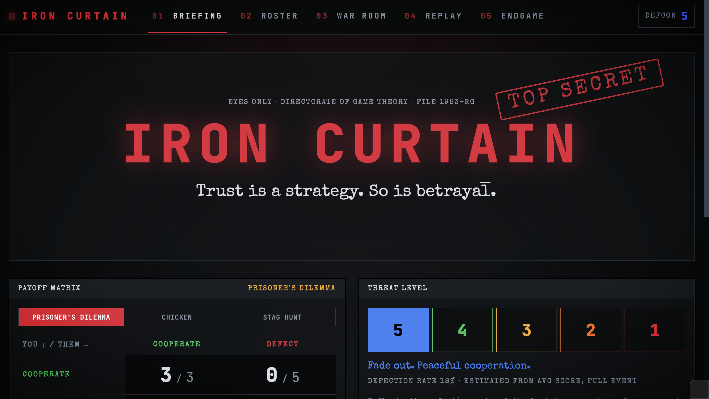
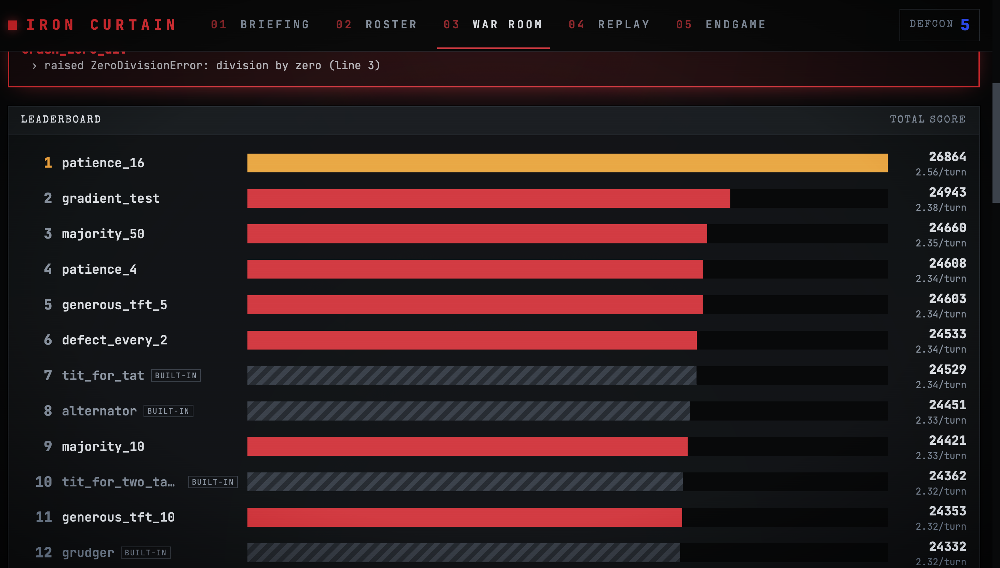
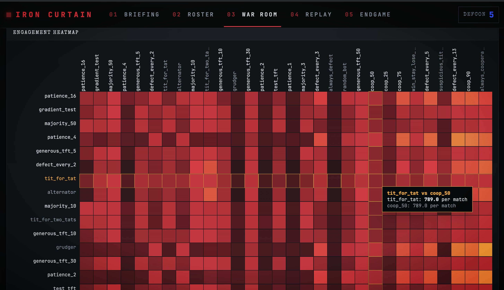
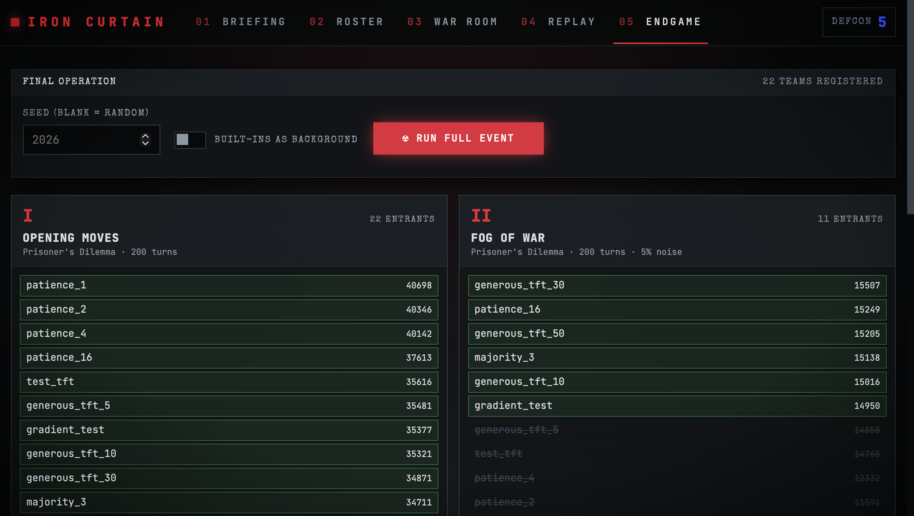

# Iron Curtain

A Cold War themed game theory bot tournament. Teams write Python bots that choose to cooperate or defect, every bot plays every other bot, and the rules change each round.



| Leaderboard | Heatmap |
|---|---|
|  |  |



## How it works

1. Each team writes a function `strategy(my_history, opp_history)` that returns `"C"` (cooperate) or `"D"` (defect).
2. Every bot plays a full match against every other bot, including a copy of itself. No brackets, no lucky draws.
3. Each round changes the rules: a different game, accidental moves (noise) or a hidden match length.
4. The bottom half is eliminated after each round until one champion remains.

The rounds in this repo are a proof of concept. Final event rounds are kept separate.

## Features

* **Game engine:** Prisoner's Dilemma, Chicken and Stag Hunt, with noise and seeded, repeatable matches
* **Sandbox:** submitted code is checked before it runs, executed in separate processes with a timeout, and disqualified cleanly if it crashes, hangs or returns an invalid move
* **Elimination events:** multi round tournaments with fair tie breaks by head to head score, then a seeded coin flip
* **Web app:** animated leaderboard, matchup heatmap, move by move replays and an elimination bracket with a champion reveal

## Stack

| Layer | Tech |
|---|---|
| Engine | Python |
| API | FastAPI, Pydantic |
| Frontend | React, Vite, Tailwind, Framer Motion, Recharts, CodeMirror |

## Running locally

**Backend**

```bash
python -m venv venv
source venv/bin/activate
pip install -r backend/requirements.txt
cd backend
uvicorn api.main:app --reload --port 8001
```

API docs: http://localhost:8001/docs

**Frontend** (in a second terminal)

```bash
cd frontend
npm install
npm run dev
```

App: http://localhost:5173

## Tests and scripts

From `backend/`:

```bash
python -m pytest              # engine and API tests
python -m scripts.event_demo  # full event with 20 demo bots
python -m scripts.stress      # 40 bot stress test, including broken bots
```

## Writing a bot

```python
def strategy(my_history, opp_history):
    # Cooperate first, then copy the opponent's last move
    if not opp_history:
        return "C"
    return opp_history[-1]
```

**Rules**

* Return `"C"` or `"D"` every turn
* Only `random` and `math` can be imported
* No `try/except`, file access, `eval` or dunder attributes
* Each match has a time limit. A bot that crashes, hangs or returns anything else is disqualified from the round

## Background

Inspired by Robert Axelrod's 1980 Prisoner's Dilemma tournaments, where Tit for Tat won without beating a single opponent head to head.
